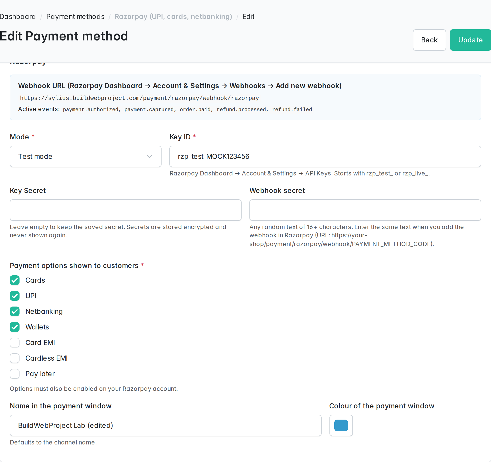
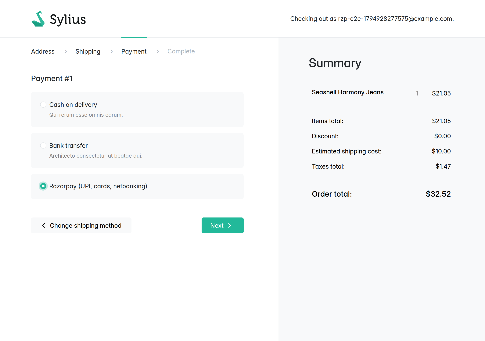
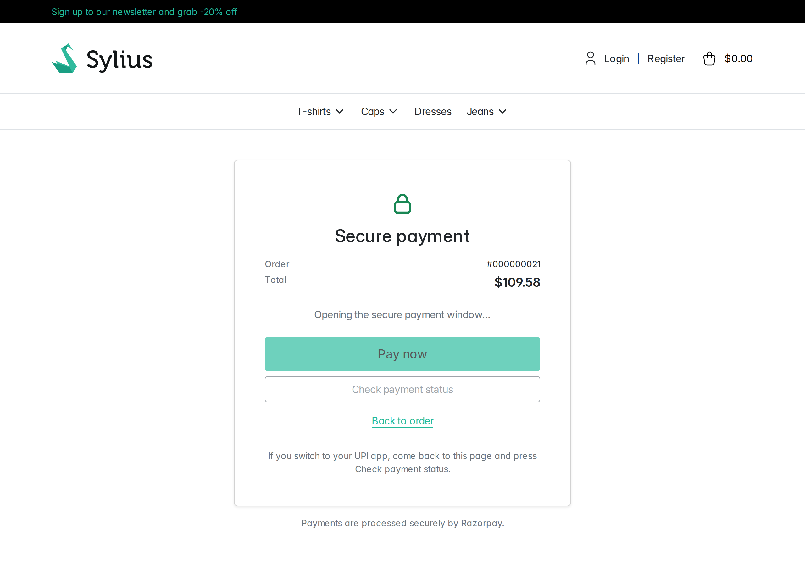
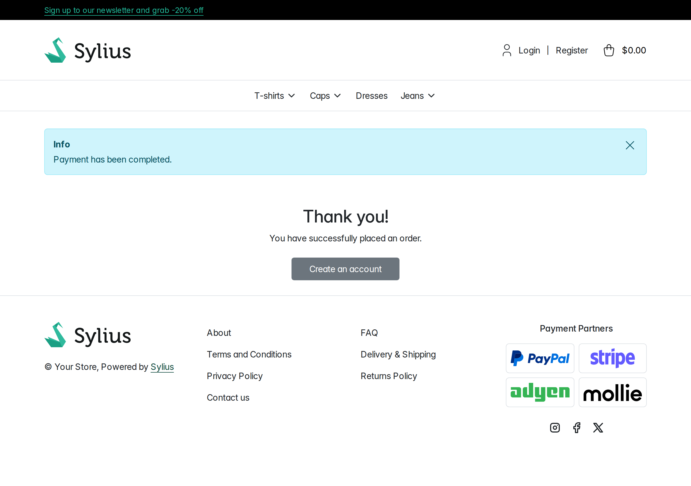
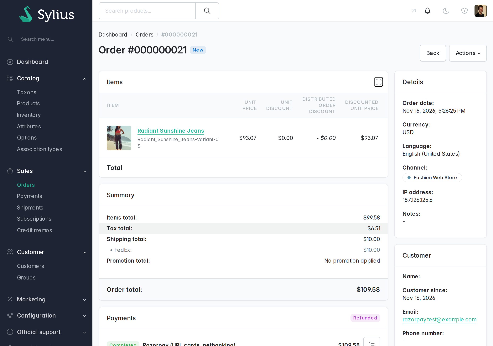
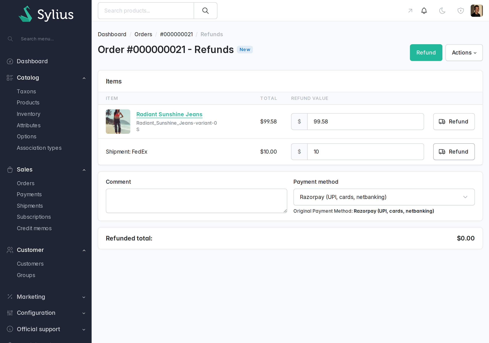

<p align="center">
    <a href="https://buildwebproject.com" target="_blank">
        
    </a>
</p>

<h1 align="center">Sylius Razorpay Plugin</h1>

<p align="center">
    Razorpay Standard Checkout for <a href="https://sylius.com">Sylius 2</a>: UPI, cards, netbanking and wallets,
    signed webhooks, automatic reconciliation and refunds from credit memos. Built on the Sylius 2 Payment Request API.
</p>

<p align="center">
    <a href="https://packagist.org/packages/buildwebproject/sylius-razorpay-plugin"></a>
    <a href="LICENSE"></a>
    
    
</p>

---

## Features

- **Razorpay Standard Checkout** (checkout.js) with UPI, cards, netbanking, wallets, EMI and pay later; choose which options customers see per payment method.
- **Native Sylius 2 flow**: Payment Request API (`capture` + `status`), the standard *pay* / *after pay* pages, thank-you page and flash messages. No Payum.
- **Money is confirmed by Razorpay, not by the browser**: the checkout signature is verified, then the payment is read back from the Razorpay API; the Sylius payment completes only when amount, currency and order match.
- **Never a second Razorpay order, never a lost payment**: a journal row (with a unique receipt) is written before the order is created, so a timeout or crash is reconciled by that receipt.
- **Signed webhooks** (`payment.authorized`, `payment.captured`, `order.paid`, `refund.*`) per payment method, with webhook-secret rotation; events are idempotent and only trigger a read from the API.
- **Automatic capture** of authorized payments if your Razorpay account is set to manual capture.
- **Refunds**: with [Sylius RefundPlugin](https://github.com/Sylius/RefundPlugin), refunding an order to "Razorpay" sends the refund to Razorpay after the credit memo is saved (once, with a receipt as idempotency key) and completes the refund payment when Razorpay processes it.
- **Review instead of guessing**: duplicate payments, amount mismatches or money arriving after cancellation are flagged for staff and never mark the order paid by themselves.
- **Reconcile command** for cron: finishes payments when the customer closed the browser and the webhook was missed.
- **Secrets stay secret**: Key Secret and webhook secret are encrypted by Sylius gateway-config encryption and never rendered back into the admin page.
- **Payment details** on the Sylius payment: Razorpay order/payment ids, method, UPI VPA / bank / wallet / card network + last 4, fee and tax.

## Screenshots

| Admin settings | Choose Razorpay at checkout |
|---|---|
|  |  |

| Secure payment page | Thank you |
|---|---|
|  |  |

| Paid order in admin | Refund to Razorpay |
|---|---|
|  |  |

## Requirements

| | Version |
|---|---|
| PHP | 8.2+ |
| Sylius | 2.1 or newer (tested on 2.3.2) |
| Database | MySQL / MariaDB (migration provided) |
| Optional | `sylius/refund-plugin` for refunds |

## Installation

1. Require the plugin:

   ```bash
   composer require buildwebproject/sylius-razorpay-plugin:^1.0@beta
   ```

   (Drop `@beta` once 1.0.0 is released.)

2. Register the bundle in `config/bundles.php`:

   ```php
   BuildWebProject\SyliusRazorpayPlugin\BuildWebProjectSyliusRazorpayPlugin::class => ['all' => true],
   ```

3. Create `config/packages/buildwebproject_sylius_razorpay.yaml`:

   ```yaml
   imports:
       - { resource: "@BuildWebProjectSyliusRazorpayPlugin/config/config.yaml" }

   buildwebproject_sylius_razorpay: ~
   ```

4. Create `config/routes/buildwebproject_sylius_razorpay.yaml`:

   ```yaml
   buildwebproject_sylius_razorpay:
       resource: "@BuildWebProjectSyliusRazorpayPlugin/config/routes/shop.yaml"
   ```

5. Run the migration, install assets and clear the cache:

   ```bash
   bin/console doctrine:migrations:migrate -n
   bin/console assets:install
   bin/console cache:clear
   ```

6. Add the reconcile command to cron (every 10 minutes):

   ```cron
   */10 * * * * cd /path/to/shop && php bin/console buildwebproject:razorpay:reconcile --env=prod >/dev/null 2>&1
   ```

## Setup in the admin

1. **Admin → Configuration → Payment methods → Create → Razorpay.**
2. Choose **Test mode**, paste the **Key ID** (`rzp_test_…`) and **Key Secret** from Razorpay Dashboard → Account & Settings → API Keys.
3. Type any random **webhook secret** (16+ characters) and choose the payment options to show.
4. Save. The form shows the **webhook URL** for this method:
   `https://your-shop/payment/razorpay/webhook/<payment method code>`
5. In Razorpay Dashboard → Account & Settings → **Webhooks → Add new webhook**: paste that URL, the same secret, and tick
   `payment.authorized`, `payment.captured`, `order.paid`, `refund.processed`, `refund.failed`.
6. Place a test order. When everything works, create a second method in **Live mode** with your live keys.

> **Currency**: Razorpay charges in the payment's currency. Indian accounts accept INR by default; other currencies need
> international payments enabled on your Razorpay account.

## Configuration

```yaml
buildwebproject_sylius_razorpay:
    api_base_url: 'https://api.razorpay.com/v1/'  # change only for tests against a mock server
    api_timeout: 10                               # seconds
    refunds: true                                 # send RefundPlugin refunds to Razorpay
```

Per-store settings (keys, mode, payment options, name and colour in the payment window) live on each payment method.

## How it works

```
Place order ─▶ Sylius "pay" (capture request) ─▶ /{locale}/razorpay/checkout/{hash}
   │                                                │  1. journal row with unique receipt (committed)
   │                                                │  2. POST /v1/orders  (only once; timeouts reconciled by receipt)
   │                                                │  3. Razorpay window ─▶ handler ─▶ signature check
   │                                                │  4. GET /v1/orders/{id}/payments ─▶ captured? amount ok?
   │                                                ▼
   │                                    Sylius payment "complete" (row-locked)
   ▼
Sylius "after pay" (status request) ─▶ thank-you page
Webhooks and the reconcile command run step 4 again if the customer never came back.
```

### Routes

| Route | Path |
|---|---|
| `buildwebproject_razorpay_checkout` | `/{_locale}/razorpay/checkout/{hash}` (only the session that pressed Pay, CSRF + rate limit) |
| `buildwebproject_razorpay_webhook` | `/payment/razorpay/webhook/{code}` (POST, HMAC-signed) |

### Database

`bwp_razorpay_transaction` (one row per Sylius payment) and `bwp_razorpay_refund` (one row per refund payment), from
migration `BuildWebProject\SyliusRazorpayPlugin\Migrations\Version20261116180000`. A Sylius payment with a Razorpay
journal cannot be deleted by accident (foreign key without cascade).

### Statuses that need staff

`bwp_razorpay_transaction.status = 'review'` with a `review_reason`: for example the customer paid twice, or paid after
the order was cancelled. Check the payment in Razorpay and refund it there if needed. The order is never marked paid
automatically in these cases.

## Security

- Checkout and webhook signatures: HMAC-SHA256, compared in constant time; webhooks accept the current and previous secret.
- The browser result is never trusted on its own: the API is always asked for the captured amount.
- The checkout page is bound to the browser session that started the payment, CSRF-protected, rate limited, `no-store`, `noindex`.
- The Razorpay client uses its own HTTP client (no automatic retries of POST), strict id validation and short timeouts.
- Report vulnerabilities privately to **buildwebproject@gmail.com**.

## Testing

```bash
composer install
vendor/bin/phpunit
```

Unit tests cover signatures, configuration validation and the API client (with a mock HTTP client). Releases are tested
end-to-end in a Sylius 2.3 shop: admin setup (validation, secrets never rendered, secrets kept on edit), guest checkout,
thank-you page, tampered signature refused, signed/unsigned webhooks, idempotent replays and refunds through RefundPlugin.

## Support

Free and open source (MIT). Need installation, Razorpay account setup, Indian-market features (COD, couriers, GST
invoices, WhatsApp) or a custom change? [BuildWebProject](https://buildwebproject.com) offers paid help:
[WhatsApp](https://wa.me/918200189043) · buildwebproject@gmail.com.
